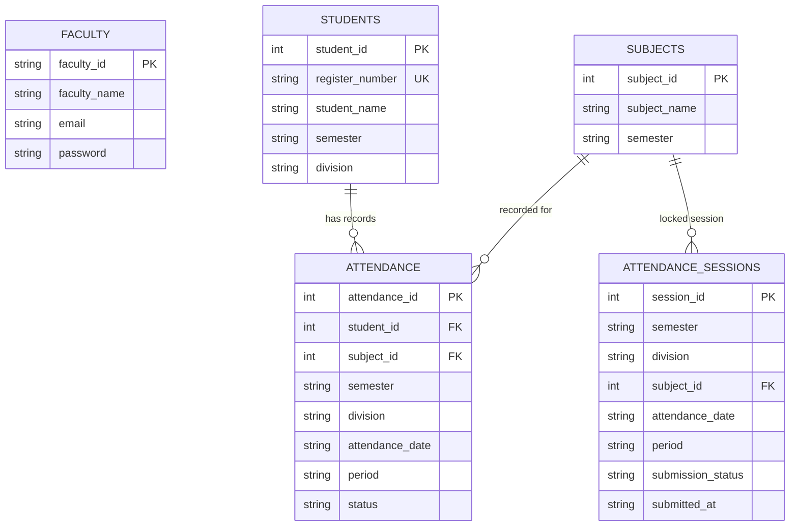

# Class Attendance Register – Android Mini Project

**Course / Degree:** Bachelor of Computer Applications (BCA)  
**Project Name:** Class Attendance Register (Semester-Wise Subject Edition)  
**Package Name:** `com.example.attendanceregister`  
**Language:** Java (Android SDK)  
**Database:** SQLite (`SQLiteOpenHelper`, Version 3)  
**UI:** XML with Android Material & AppCompat Components  

---

## 1. Project Overview & Features

**Class Attendance Register** is an enterprise-grade student attendance management application engineered for college faculty. 

### Key Capabilities:
1. **Semester Selection (Semesters 1 to 6):** Faculty must select a semester before selecting a division and subject. Attendance records across semesters remain strictly separated.
2. **Division Selection (A1 to A6):** Every semester supports six distinct divisions (`A1`, `A2`, `A3`, `A4`, `A5`, `A6`). Students belonging to `A1` are never mixed or displayed in other divisions.
3. **Semester-Wise Subject Management:**
   - Every semester possesses its own independent curriculum and subject catalog.
   - When faculty selects a semester on the Select Class or Report screen, the Subject Spinner dynamically updates to load **only** that semester's subjects.
   - Subjects from Semester 1 never appear in Semester 2, 3, 4, 5, or 6.
   - Dedicated **Subject Management** screen allows adding, updating, and deleting subjects semester-wise.
   - Composite `UNIQUE (semester, subject_name)` constraint prevents duplicate subject names within the same semester.
   - **Safe Data Preservation:** Prohibits deleting any subject that has existing attendance records saved.
4. **Permanent Attendance Session Lock:**
   - Identified by 5 session keys: **(Semester, Division, Subject, Attendance Date, Period)**.
   - Once saved, the session is **permanently locked** in SQLite.
   - Faculty cannot mark attendance again for the same period.
   - Re-opening or clicking displays: *"Attendance Already Submitted. This Session Is Locked."*
   - Real-time visual status indicator:
     - `🟢 STATUS: NOT SUBMITTED` – Ready to mark attendance.
     - `🔒 STATUS: SUBMITTED / LOCKED` – Attendance completed and locked.
   - Preserved across app restarts via the dedicated `AttendanceSessions` table.
5. **Advanced Report Filters:** Filter attendance statistics by Semester, Division (A1–A6), Subject (dynamically loaded for chosen semester), and Date with automatic **< 75% Shortage Alerts in RED**.

---

## 2. Semester-Wise Default Subject Curriculum

When initialized, `DBHelper.java` seeds independent subjects for all six semesters:

| Semester | Subjects Preloaded in SQLite |
|:---|:---|
| **Semester 1** | • C Programming • Digital Electronics • Discrete Mathematics • Communication Skills |
| **Semester 2** | • Data Structures using C • Computer Organization • Database Concepts • Numerical Analysis |
| **Semester 3** | • Object Oriented Programming (C++) • Database Management System • Operating System Concepts • Software Engineering |
| **Semester 4** | • Java Programming • Computer Networks • Python Programming • Design and Analysis of Algorithms |
| **Semester 5** | • Advanced Java Programming • Android App Development • Web Technologies (HTML/CSS/JS) • Information Security |
| **Semester 6** | • Cloud Computing • Machine Learning Basics • Mobile Computing • Project Work / Seminar |

---

## 3. SQLite Database Design & Schemas (Version 3)

### Table 3: Subjects (`Subjects`)
- `subject_id` (INTEGER, Primary Key Autoincrement)
- `subject_name` (TEXT, Not Null)
- `semester` (TEXT, Not Null: e.g. "Semester 1", "Semester 5")
- **Constraint:** `UNIQUE (semester, subject_name)`

---

## 4. How to Verify Semester-Wise Subject Management

1. **Test Dynamic Subject Spinner on Select Class Screen:**
   - Open **Select Class**.
   - Change Semester to **Semester 1**: Subject Spinner instantly displays `C Programming`, `Digital Electronics`, etc.
   - Change Semester to **Semester 4**: Subject Spinner updates to `Java Programming`, `Computer Networks`, `Python Programming`, etc.
   - Change Semester to **Semester 5**: Subject Spinner updates to `Advanced Java Programming`, `Android App Development`, etc.
   - Verify that subjects from one semester are never displayed in another.
2. **Test Subject Management Module:**
   - From the Dashboard, click **Manage Subjects**.
   - Switch Semester filter: observe subjects listed semester-wise.
   - Click **+ Add Subject**: select Semester 5, enter a new subject (e.g. `Data Mining`), and save.
   - Attempt to add `Data Mining` to Semester 5 again: notice validation prevents duplicate names within the same semester.
   - Delete a subject without attendance records: deleted successfully.
   - Attempt to delete a subject with existing attendance records: system displays an `AlertDialog` warning and safely blocks deletion to preserve academic records.
3. **Test Independent Attendance Sessions:**
   - In Semester 5, Division A1, mark attendance for **Android App Development** on Period 1.
   - Notice Period 1 for *Android App Development* becomes `🔒 LOCKED`.
   - Switch subject to **Advanced Java Programming** for the same date and period: status is `🟢 NOT SUBMITTED`, proving sessions are independent per subject.
4. **Test Semester-Wise Report Filtering:**
   - Open **Attendance Reports**.
   - Select **Semester 4**: Subject filter updates strictly with Semester 4 subjects.
   - Select **Semester 5**: Subject filter updates strictly with Semester 5 subjects.
